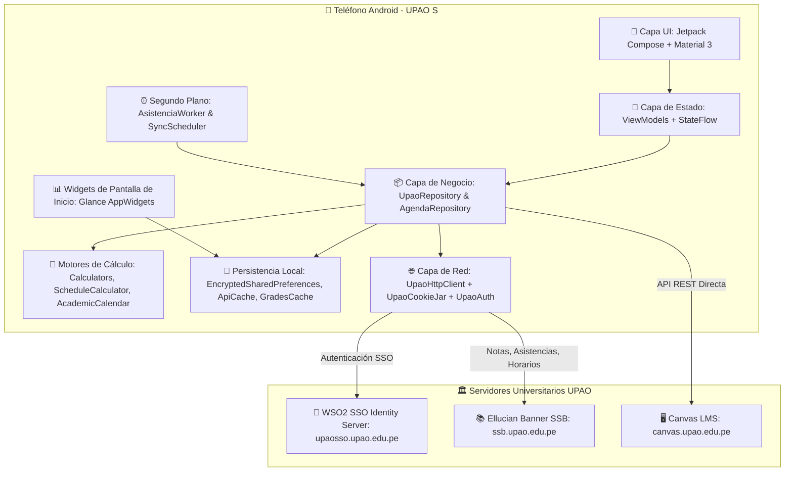

# 📱 INFORME TÉCNICO Y DE ARQUITECTURA: PROYECTO UPAO S

> **Fecha de elaboración**: 18 de Octubre de 2026  
> **Versión de la aplicación**: v1.6.4 (Build 15)  
> **Plataforma**: Android Nativo (Kotlin + Jetpack Compose)  
> **Tipo de Aplicación**: Cliente Universitario Autónomo (Conexión Directa App → UPAO)

---

## 1. ¿QUÉ ES UPAO S?

**UPAO S** es una aplicación móvil nativa para Android diseñada específicamente para estudiantes de la **Universidad Privada Antenor Orrego (UPAO)**. 

### Propósito y Filosofía
Originalmente, la aplicación utilizaba una arquitectura cliente-servidor tradicional (`App -> Backend en Render -> UPAO`). En la versión actual, **se eliminó por completo la dependencia de cualquier backend o servidor intermediario**. 

La aplicación opera bajo una **arquitectura 100% cliente-servidor directo (`App -> UPAO`)**:
- La aplicación se comunica directamente desde el teléfono con los servidores oficiales de la UPAO (**WSO2 Identity Server** y **Ellucian Banner Student Self-Service v9**).
- No recopila, transmite ni almacena datos en servidores de terceros.
- Todas las operaciones de autenticación, cálculo de promedios ponderados, predicción de notas, detección de límites de inasistencia, almacenamiento en caché y generación de notificaciones se procesan **localmente en el dispositivo**.

---

## 2. ARQUITECTURA GENERAL DEL SISTEMA



### Principios Fundamentales de la Arquitectura
1. **Conexión Directa y Cero Intermediarios**: No existe Render, AWS, Firebase ni proxies. La IP que contacta a la UPAO es la conexión móvil o WiFi del usuario, eliminando bloqueos por captchas causados por servidores compartidos.
2. **Seguridad y Cero Secretos**: Las credenciales se guardan localmente cifradas mediante Android Keystore (`EncryptedSharedPreferences`). Las cookies de sesión universitaria viven exclusivamente en memoria RAM en `UpaoCookieJar` y se destruyen al cerrar sesión.
3. **Resiliencia Offline-First**: Si el portal de la UPAO se cae o el teléfono pierde cobertura, la aplicación continúa mostrando las últimas notas, asistencias, horarios y widgets gracias a su capa de caché local.
4. **Notificaciones Locales Autónomas**: Un Worker programado con WorkManager y AlarmManager revisa en segundo plano periódicamente el portal y genera notificaciones del sistema Android ante nuevas calificaciones o registros de asistencia.

---

## 3. MÓDULOS Y FUNCIONALIDADES DETALLADAS

### 3.1. Pantalla "Hoy" (Dashboard Principal)
- **Tarjeta de Próxima Clase**: Muestra en tiempo real la clase en curso o la siguiente del día, indicando materia, hora de inicio/fin, pabellón, aula, tipo de sesión (teoría, práctica, laboratorio) y docente.
- **Banner de Semana Académica**: Muestra la semana en curso respecto al calendario semestral de 16 semanas (ej. *"Semana 7 de 16"*). **Solo se muestra en esta pestaña para mantener las demás pantallas limpias**.
- **Promedio Ponderado Semestral (PPS)**: Indicador visual del PPS del ciclo actual con desglose de créditos acumulados y estado de aprobación.
- **Acceso Rápido a Notificaciones y Agenda**: Tarjetas interactivas con alertas recientes y recordatorios pendientes de Canvas.

### 3.2. Módulo de Cursos y Calificaciones (Grades)
- **Listado de Asignaturas**: Visualización de materias inscritas con código, número de curso, créditos, nombre del docente y estado de aprobación.
- **Nota Actual Progresiva**: Cálculo exacto del acumulado a la fecha considerando únicamente los componentes ya evaluados.
- **Detalle y Desglose de Evaluaciones**:
  - Desglose por componentes principales (Evaluación Continua 1, Parcial, Evaluación Continua 2, Examen Final).
  - Subcomponentes y evaluaciones parciales con peso porcentual individual (`displayPeso`).
- **Simulador y Nota Proyectada**:
  - Calcula automáticamente qué nota mínima se necesita en las evaluaciones restantes para alcanzar la nota mínima aprobatoria institucional (**10.5**).
- **Cálculo Oficial del PPS**:
  - Resuelve la discrepancia histórica de cálculo: incluye la totalidad de cursos inscritos (aprobados y desaprobados) multiplicando cada calificación por sus créditos académicos reales y dividiendo entre la suma total de créditos.

### 3.3. Módulo de Horario Semanal
- **Vista por Días y Vista Semanal**: Visualización dinámica de lunes a sábado.
- **Normalización de Espacios Físicos**: Traduce los códigos internos de Banner en nombres claros (ej. *"Pabellón H - Aula 302"*).
- **Fusión de Bloques Continuos**: Si una materia tiene 3 horas consecutivas divididas administrativamente en Banner, el motor `ScheduleCalculator` las fusiona visualmente en un único bloque continuo.
- **Docentes Asignados**: Resuelve los nombres completos de los profesores mediante el historial de registro y cruce de eventos de Banner.

### 3.4. Módulo de Asistencia y Límite de Inhabilitación (30%)
- **Agrupación por Naturaleza de Clase**: Separa y desglosa las horas de **Teoría**, **Práctica** y **Laboratorio**.
- **Monitoreo del 30% de Inasistencias**:
  - Calcula el límite institucional exacto de faltas permitidas antes de la inhabilitación del curso.
  - Alerta visual mediante insignias de estado: *Normal* (verde), *En Riesgo* (amarillo/naranja) y *En Peligro Crítico* (rojo).
  - Contador explícito de *"Faltas restantes permitidas"*.

### 3.5. Integración Nativa con Canvas LMS
- **Conexión Directa al API de Canvas**: (`https://canvas.upao.edu.pe/api/v1`) utilizando el token de acceso personal del estudiante.
- **Tareas y Evaluaciones Pendientes (`To-Do List`)**: Sincronización en vivo con fechas de entrega, estado de sumisión y puntuaciones.
- **Módulos y Archivos de Curso**: Navegación de carpetas, visualización de PDFs y enlaces subidos por los docentes.
- **Anuncios y Discusiones**: Notificaciones y lectura de anuncios oficiales publicados en cada asignatura.
- **Subida y Entrega de Tareas**: Flujo en dos pasos (inicialización de subida en Canvas + confirmación de entrega del archivo).

### 3.6. Calculadora de Notas
- Herramienta predictiva interactiva que permite a los estudiantes modificar notas tentativas o ingresar diferentes escenarios de calificaciones para ver el impacto en su promedio final y PPS.

### 3.7. Notificaciones Locales y Trabajo en Segundo Plano
- **`AsistenciaWorker`**: Tarea de sincronización ejecutada cada 5 minutos mediante WorkManager.
- **Comparación de Snapshots Locales**:
  - Descarga las notas y asistencias actuales de Banner.
  - Las compara con la última instantánea guardada en SharedPreferences.
  - Si detecta una nota modificada/publicada o un nuevo registro de falta/asistencia, genera una notificación local en Android y la guarda en el buzón local de notificaciones.
- **Compatibilidad con Fabricantes (Xiaomi, Samsung, Huawei)**: Incluye detección y accesos directos para eximir la app del ahorro agresivo de batería del sistema operativo.

### 3.8. Widgets de Pantalla de Inicio (Android Glance)
- **`ResumenNotasWidget`**: Muestra en el escritorio de Android el PPS actual, los cursos y las últimas notas registradas.
- **`ProximoCursoWidget`**: Muestra la siguiente clase del día con horario y aula, actualizándose automáticamente sin necesidad de abrir la app.

### 3.9. Multi-Cuenta y Gestión de Privacidad
- **Soporte Multi-Estudiante**: Permite almacenar múltiples cuentas en el mismo celular y alternar entre ellas con un solo toque.
- **Aislamiento Total**: Cada cuenta cuenta con su propio almacén de cookies en memoria y su propia partición de caché local.
- **Borrado de Datos**: La opción *"Cerrar sesión y borrar datos locales"* elimina de forma inmediata e irrecuperable las credenciales, cachés, recordatorios y notificaciones guardadas en el teléfono.

---

## 4. ESTRUCTURA DE ARCHIVOS Y CARPETAS

```text
app/src/main/java/com/example/upaos/
│
├── MainActivity.kt                      # Actividad principal, NavHost de Compose y receptor de intents
│
├── data/
│   ├── upao/                            # 🚀 NÚCLEO DE CONEXIÓN DIRECTA CON UPAO
│   │   ├── AcademicCalendar.kt          # Calendario de semanas (16 semanas, inicio 31-ago-2026)
│   │   ├── BannerApi.kt                 # Cliente HTTP para endpoints de Banner SSB v9
│   │   ├── Calculators.kt               # Algoritmos de PPS oficial, notas proyectadas y ponderados
│   │   ├── ScheduleCalculator.kt        # Procesador de horarios, aulas y unión de bloques
│   │   ├── UpaoAuth.kt                  # Autenticación directa SSO WSO2 sin captcha y auto-relogin
│   │   ├── UpaoCookieJar.kt             # CookieJar multi-cuenta en memoria RAM
│   │   ├── UpaoExceptions.kt            # Excepciones de red y sesión expirada
│   │   ├── UpaoHttpClient.kt            # Cliente OkHttpClient optimizado (sin logging de secretos)
│   │   └── UpaoRepository.kt            # Fachada unificada de datos y notificaciones locales
│   │
│   ├── api/                             # Integraciones con APIs REST externas
│   │   ├── CanvasApiService.kt          # Retrofit interface directa con Canvas LMS UPAO
│   │   └── ApiErrors.kt                 # Mapeador de mensajes de error amigables
│   │
│   ├── local/                           # 💾 PERSISTENCIA Y SEGURIDAD LOCAL
│   │   ├── TokenManager.kt              # Almacén cifrado de contraseñas (EncryptedSharedPreferences)
│   │   ├── ApiCache.kt                  # Caché en disco para respuestas de Banner
│   │   ├── GradesCache.kt               # Caché local optimizada para calificaciones y PPS
│   │   ├── CanvasCache.kt               # Caché local de cursos y tareas de Canvas
│   │   ├── NotificationPreferences.kt   # Preferencias de activación de alertas y sincronización
│   │   ├── ThemePreferences.kt          # Modo oscuro / claro persistente
│   │   └── AccountPrivacy.kt            # Limpieza profunda de cachés, cookies y credenciales
│   │
│   ├── model/                           # 📋 MODELOS DE DATOS TIPADOS
│   │   ├── GradesModels.kt              # CursoGrades, ComponenteDetalle, DetalleCursoResponse
│   │   ├── HorarioModels.kt             # HorarioResponse, CursoHorario, BloqueHorario, DiaHorario
│   │   ├── AsistenciaModels.kt          # AsistenciaResponse, CursoAsistencia, ComponenteAsistencia
│   │   ├── CanvasModels.kt              # CanvasCourse, CanvasAssignment, CanvasSubmission
│   │   ├── FeaturesModels.kt            # SemanaInfo, PromedioPeriodoResponse, PromedioCursoItem
│   │   ├── NotificacionModels.kt        # NotificacionItem, NotificacionesResponse
│   │   └── AuthModels.kt                # LoginResponse
│   │
│   ├── agenda/                          # Recordatorios locales y agenda de entregas
│   └── refresh/                         # Mutex y puertas de refresco en primer plano
│
├── service/                             # ⚙️ SERVICIOS Y TAREAS EN SEGUNDO PLANO
│   ├── AsistenciaWorker.kt              # Worker de WorkManager para sincronización periódica
│   ├── BackgroundSyncReceiver.kt        # Receptor para alarmas exactas cada 5 min y tras reinicio
│   ├── SyncScheduler.kt                 # Orquestador del intervalo de ejecución (5 minutos)
│   ├── AgendaReminderWorker.kt          # Notificaciones anticipadas de tareas de Canvas
│   └── NotificationService.kt           # Constructor y emisor de notificaciones locales de Android
│
├── ui/                                  # 🎨 INTERFAZ DE USUARIO (JETPACK COMPOSE)
│   ├── home/                            # HomeScreen, TodayContent, DashboardViewModel
│   ├── grades/                          # GradesScreen, CourseDetailScreen
│   ├── horario/                         # HorarioScreen, bloques semanales y selección de días
│   ├── asistencia/                      # AsistenciaScreen, desglose de componentes y límite 30%
│   ├── canvas/                          # CanvasScreen, CanvasCourseDetailView, entrega de tareas
│   ├── calculadora/                     # CalculadoraScreen interactiva
│   ├── notificaciones/                  # NotificacionesScreen (buzón local)
│   ├── settings/                        # SettingsScreen, PrivacyControls
│   ├── login/                           # LoginScreen, EligeCuentaScreen
│   ├── components/                      # Componentes reutilizables (AppCard, Badges, Botones, etc.)
│   └── theme/                           # Color.kt, Theme.kt, Type.kt (Diseño institucional UPAO)
│
└── widget/                              # 📊 WIDGETS DE ESCRITORIO (ANDROID GLANCE)
    ├── ResumenNotasWidget.kt            # Widget de notas y promedio en pantalla de inicio
    └── ProximoCursoWidget.kt            # Widget de siguiente clase y aula
```

---

## 5. FLUJOS PRINCIPALES DEL SISTEMA

### 5.1. Flujo de Autenticación SSO Directa (`UpaoAuth`)
1. **Inicio de Solicitud**: `UpaoAuth.loginDirecto(usuario, password)` realiza un `GET` a `https://ssb.upao.edu.pe/StudentSelfService/ssb/studentGrades`.
2. **Redirección WSO2**: Banner redirige automáticamente al servidor de identidad `https://upaosso.upao.edu.pe:410/commonauth`.
3. **Parseo de Formulario**: Mediante **Jsoup**, se extrae la URL de envío (`action`) y los tokens de seguridad de la sesión de WSO2 (`sessionDataKey`).
4. **Envío de Credenciales**: Se realiza un `POST` con las credenciales directamente a WSO2 emulando un navegador móvil Android.
5. **Establecimiento de Cookies**: WSO2 valida las credenciales y devuelve cookies de sesión (`JSESSIONID`, `commonAuthId`, etc.), que son absorbidas por `UpaoCookieJar` y asociadas a la cuenta.
6. **Extracción del Nombre**: Se analiza el HTML de respuesta para extraer el nombre y apellidos completos del estudiante y persistirlos en `TokenManager`.

### 5.2. Flujo de Sincronización en Segundo Plano y Notificaciones
1. Cada 5 minutos, `SyncScheduler` activa `AsistenciaWorker` mediante `WorkManager`.
2. `AsistenciaWorker` obtiene las credenciales cifradas del usuario activo desde `TokenManager`.
3. Invoca `UpaoAuth.ensureSession()`: si la sesión en memoria sigue viva, continúa; si expiró, realiza re-autenticación automática en segundo plano de forma transparente.
4. Consulta notas y asistencias mediante `UpaoRepository`.
5. Compara los datos recibidos con las instantáneas previas almacenadas en disco:
   - Si una nota cambió o se publicó: dispara `NotificationService.mostrarNotificacionNotas()`.
   - Si una falta o asistencia fue registrada: dispara `NotificationService.mostrarNotificacionAsistencia()`.
6. Guarda la nueva alerta en el historial de `NotificacionesScreen` para que el estudiante pueda revisarla en cualquier momento.

---

## 6. TECNOLOGÍAS Y LIBRERÍAS UTILIZADAS

| Categoría | Librerías / Herramientas |
| :--- | :--- |
| **Lenguaje de Programación** | Kotlin 2.0.0 (con Compose Compiler Plugin integrado) |
| **UI Framework** | Jetpack Compose (BOM 2024.09.00) + Material 3 + Extended Icons |
| **Navegación** | Jetpack Navigation Compose 2.7.7 |
| **Cliente de Red** | Square OkHttp 4.12.0 + okhttp-urlconnection (JavaNetCookieJar) |
| **Parsing HTML / Scraping** | Jsoup 1.17.2 (análisis robusto de DOM y formularios) |
| **Parsing JSON** | Google Gson 2.11.0 + Retrofit 2.11.0 (exclusivo para Canvas LMS) |
| **Seguridad y Cifrado** | AndroidX Security Crypto 1.1.0-alpha06 (`EncryptedSharedPreferences`) |
| **Concurrencia Reactiva** | Kotlin Coroutines 1.8.1 + StateFlow / SharedFlow |
| **Tareas en Background** | AndroidX WorkManager 2.9.1 + BroadcastReceivers + AlarmManager |
| **Widgets de Escritorio** | AndroidX Glance 1.1.1 (Widgets modernos con Jetpack Compose) |
| **Pruebas Automatizadas** | JUnit 4 + Kotlinx Coroutines Test |
| **Compatibilidad Android** | `minSdk 24` (Android 7.0+) \| `targetSdk 37` \| `compileSdk 37` |

---

## 7. RESUMEN DE BENEFICIOS TRAS LA MIGRACIÓN

1. **Velocidad Inmediata**: Al eliminar el salto intermedio hacia servidores en Render (frecuentemente ubicados en Estados Unidos o Europa), las consultas van directamente desde el operador móvil peruano a los servidores de UPAO en Trujillo/Lima, reduciendo la latencia drásticamente.
2. **Cero Dependencia de Terceros**: La app no depende de que un backend esté encendido, ni de planes gratuitos o de pago en la nube.
3. **Privacidad Absoluta**: Ningún dato académico, nota, horario o contraseña pasa por ningún servidor ajeno a la propia UPAO y al teléfono del usuario.
4. **Cero Captchas**: La autenticación móvil nativa no activa los filtros anti-bot que afectaban a los servidores de Render por tráfico compartido.
5. **Autonomía Operativa**: La app es 100% autosuficiente para su uso personal.
